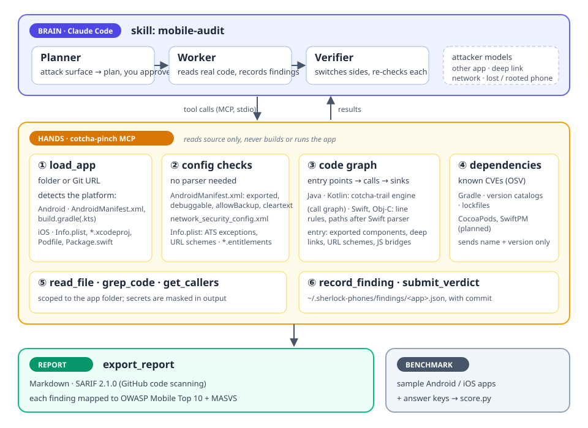

  

<b>A pocket detective that sniffs out security bugs in Android and iOS app source code (Claude Code plugin + MCP server)</b>

  
  
  

[English](#english) · [한국어](#한국어)

> 🚧 **Design stage.** This README describes what Phonetective will do. Nothing below is usable yet; see [Progress](#progress).

*Phonetective* = **phone** + de**tective**. Point it at your app's source folder in Claude Code and say *"audit this app"*. Claude walks the app's **attack surface → dangerous code** paths, reads the real code, records only what it can show is exploitable, then switches sides and re-checks every finding before writing a report mapped to the **OWASP Mobile Top 10** and **MASVS**.

It is the mobile sibling of [mcp-code-agent](https://github.com/yeomyaloo/mcp-code-agent) (Java/Spring servers) and reuses its idea: **Claude is the brain, the MCP server is the hands.**

- **Runs on your Claude Code login.** No separate API key, no database, no server to host. Only Java 17+.
- **Reads source only.** It never builds, installs or runs the app, and needs no Mac, emulator or device.
- **Fewer false alarms.** Pattern scanners flag every `WebView` and `rawQuery`. Phonetective asks the next question: *can another app, a link, the network or someone holding the phone actually reach it?*

## How it works

1. **Load the app** from a folder or a public Git URL; the platform is detected from `AndroidManifest.xml` / `build.gradle` or `Info.plist` / `*.xcodeproj` / `Podfile`.
2. **Config checks** that need no parser: manifest flags, network security config, App Transport Security exceptions, URL schemes, entitlements.
3. **Code graph**: entry points (exported components, deep links, URL schemes, WebView JS bridges) → calls → sinks. Java gets a full call graph (JavaParser); Kotlin, Swift and Objective-C start with line rules and move to tree-sitter parsing later.
4. **Dependencies**: library versions → known vulnerabilities from OSV (only names and versions leave your machine).
5. **Claude investigates** each item with `read_file` / `grep_code` / `get_callers`, records findings with code evidence, and a verifier pass tries to prove each one wrong.
6. **Report**: Markdown or SARIF 2.1.0 (GitHub code scanning), each finding tagged with CWE, OWASP Mobile Top 10 and MASVS.

## Who attacks a mobile app

Every check is tied to one of four attackers, and the verifier judges a finding against that attacker, not against "someone sending HTTP requests".

## What it will check

| Area | Android | iOS | OWASP Mobile |
|---|---|---|---|
| Misconfiguration | exported components without a permission (CWE-926), `debuggable` (CWE-489), `allowBackup` (CWE-530) | URL schemes without validation, risky entitlements | M8 |
| Insecure communication | `usesCleartextTraffic`, `network_security_config` trusting user CAs, trust-all `TrustManager`, `HostnameVerifier` off, `SslErrorHandler.proceed()` (CWE-295, CWE-319) | `NSAllowsArbitraryLoads` and other ATS exceptions, `URLSession` delegates that accept any certificate | M5 |
| Platform interaction | Intent redirection, mutable `PendingIntent` (CWE-927), `ContentProvider` SQL / path injection, `addJavascriptInterface` (CWE-749), WebView file access | `WKScriptMessageHandler` bridges, untrusted URLs into `WKWebView` | M4 |
| Input validation | `SQLiteDatabase.rawQuery` / `execSQL` with concatenated input (CWE-89), path traversal (CWE-22) | `sqlite3_exec` with formatted strings (CWE-89), path traversal | M4 |
| Data storage | tokens in `SharedPreferences`, external storage, secrets in `Log` (CWE-312, CWE-532) | tokens in `UserDefaults` instead of Keychain, secrets in `NSLog` / `print` | M9 |
| Cryptography | ECB mode, MD5/SHA-1, hardcoded keys, `java.util.Random` (CWE-327, CWE-321, CWE-330) | ECB in CommonCrypto, hardcoded keys | M10 |
| Credentials | hardcoded API keys and secrets (masked in all output, CWE-798) | same | M1 |
| Supply chain | Gradle, version catalogs, lockfiles → OSV | CocoaPods, SwiftPM (planned) | M2 |

Not in scope: compiled APK/IPA analysis, runtime instrumentation (Frida), binary protections such as obfuscation and anti-tampering (M7) beyond what the build config shows.

## Planned tools

| Tool | What it does |
|---|---|
| `load_app` | Load a folder or public Git URL, detect the platform, build the code graph |
| `list_apps` | Loaded apps |
| `list_components` | Entry points: exported Activity / Service / Receiver / Provider, deep links, URL schemes, JS bridges |
| `list_sinks` · `list_sink_paths` | Dangerous code, and the paths from entry points to it |
| `check_config` | Manifest, network security config, Info.plist and entitlements findings |
| `check_dependencies` | Libraries with known vulnerabilities (OSV) |
| `read_file` · `grep_code` · `get_callers` · `get_callees` | Read code inside the app folder only |
| `record_finding` · `list_findings` · `submit_verdict` · `clear_findings` | Findings and verifier verdicts (`~/.phonetective/findings/<app>.json`) |
| `export_report` | Markdown or SARIF |

## Progress

| # | Step | Status |
|---|---|---|
| 0 | Name, logo, design, threat model | ✅ Done |
| 1 | Android: config checks, Java code graph with component entry points, Android sinks, Kotlin line rules, `mobile-audit` skill, benchmark app with an answer key | ⏳ Planned |
| 2 | iOS: Info.plist / entitlements checks, Swift and Objective-C line rules, iOS benchmark app | ⏳ Planned |
| 3 | tree-sitter parsing for Kotlin and Swift, so paths are followed across files | ⏳ Planned |
| 4 | CocoaPods and SwiftPM dependencies | ⏳ Planned |

## Principles

- **Read only.** The app under audit is never built, installed or executed.
- **Code evidence or it didn't happen.** A finding needs a file, a line and the code that proves it; the verifier tries to refute every one.
- **Secrets stay secret.** Keys found in code are masked in tool output, findings and reports.
- **Minimal data leaves the machine.** Only library names and versions are sent to OSV; source code is never uploaded anywhere except to Claude through your own Claude Code session.

## License

[Apache License 2.0](LICENSE).

## Disclaimer

Use Phonetective only on apps you own or are authorized to test. Automated findings can be wrong in both directions; a clean report is not proof that an app is secure.

---

# 한국어

*Phonetective* = **phone**(폰) + de**tective**(탐정). 폰 탐정이에요. Claude Code에서 앱 소스 폴더를 주고 *"이 앱 보안 검사해줘"*라고 하면, Claude가 앱의 **공격 입구 → 위험한 코드** 경로를 따라가며 실제 코드를 읽어요. 공격 가능함을 코드로 보여줄 수 있는 것만 기록하고, 입장을 바꿔 발견마다 다시 확인한 뒤 **OWASP Mobile Top 10**과 **MASVS** 기준으로 보고서를 써요.

[mcp-code-agent](https://github.com/yeomyaloo/mcp-code-agent)(Java/Spring 서버용)의 모바일 버전이고, 같은 생각을 이어받았어요. **Claude는 두뇌, MCP 서버는 손발**이에요.

> 🚧 **설계 단계예요.** 이 README는 Phonetective가 할 일을 설명해요. 아직 쓸 수 있는 기능은 없어요. [진행 상황](#진행-상황)을 보세요.

- **Claude Code 로그인으로 돌아요.** 따로 넣을 API 키, DB, 띄울 서버가 없어요. Java 17 이상만 있으면 돼요.
- **소스만 읽어요.** 앱을 빌드하거나 설치하거나 실행하지 않아요. Mac, 에뮬레이터, 실제 기기도 필요 없어요.
- **헛경보가 적어요.** 패턴 검사기는 `WebView`, `rawQuery`만 보이면 다 경고해요. Phonetective는 한 걸음 더 물어요. *다른 앱, 링크, 네트워크, 폰을 손에 쥔 사람이 정말 거기까지 닿을 수 있나?*

## 동작 방식

1. **앱 불러오기**: 폴더나 공개 Git 주소를 받아요. 플랫폼은 `AndroidManifest.xml`·`build.gradle`, 또는 `Info.plist`·`*.xcodeproj`·`Podfile`로 알아내요.
2. **설정 검사**: 파서 없이 바로 돼요. 매니페스트 속성, 네트워크 보안 설정, ATS(App Transport Security) 예외, URL 스킴, entitlements.
3. **코드 그래프**: 진입점(외부에 열린 컴포넌트, 딥링크, URL 스킴, WebView JS 브리지) → 호출 → 위험 지점. Java는 JavaParser로 호출 관계까지 만들어요. Kotlin, Swift, Objective-C는 줄 단위 규칙으로 시작하고 나중에 tree-sitter로 파싱해요.
4. **라이브러리**: 라이브러리 버전 → OSV의 알려진 취약점. 밖으로 나가는 건 이름과 버전뿐이에요.
5. **Claude가 조사**: 항목마다 `read_file`·`grep_code`·`get_callers`로 실제 코드를 읽고, 코드 근거와 함께 발견을 기록해요. 검증 단계에서는 발견마다 틀렸음을 증명해 보려고 해요.
6. **보고서**: Markdown 또는 SARIF 2.1.0(GitHub 코드 스캐닝). 발견마다 CWE, OWASP Mobile Top 10, MASVS를 달아요.

## 누가 모바일 앱을 공격하나

검사 항목은 모두 네 공격자 중 하나와 이어져 있어요. 검증할 때도 "HTTP 요청을 보내는 사람"이 아니라 그 공격자 기준으로 판단해요.

- 😈 **폰에 깔린 악성 앱**: Intent를 보내고 ContentProvider를 읽어요.
- 🔗 **조작된 링크**: 딥링크, URL 스킴, 웹 콘텐츠로 들어와요.
- 📡 **같은 네트워크의 누군가**: 공용 와이파이나 프록시로 통신을 가로채요(MITM).
- 📱 **잃어버리거나 루팅된 폰**: 앱이 남긴 저장소, 백업, 로그를 읽어요.

## 검사할 것

| 분야 | Android | iOS | OWASP Mobile |
|---|---|---|---|
| 설정 오류 | 권한 없이 외부에 열린 컴포넌트(CWE-926), `debuggable`(CWE-489), `allowBackup`(CWE-530) | 검증 없는 URL 스킴, 위험한 entitlements | M8 |
| 안전하지 않은 통신 | `usesCleartextTraffic`, 사용자 인증서를 믿는 `network_security_config`, 모든 인증서를 믿는 `TrustManager`, 꺼진 `HostnameVerifier`, `SslErrorHandler.proceed()`(CWE-295, CWE-319) | `NSAllowsArbitraryLoads` 등 ATS 예외, 아무 인증서나 받는 `URLSession` delegate | M5 |
| 플랫폼 연동 | Intent 리다이렉션, 변경 가능한 `PendingIntent`(CWE-927), `ContentProvider`의 SQL·경로 주입, `addJavascriptInterface`(CWE-749), WebView 파일 접근 | `WKScriptMessageHandler` 브리지, `WKWebView`에 신뢰할 수 없는 URL | M4 |
| 입력 검증 | 입력을 이어 붙인 `SQLiteDatabase.rawQuery`·`execSQL`(CWE-89), 경로 조작(CWE-22) | 문자열 포맷으로 만든 `sqlite3_exec`(CWE-89), 경로 조작 | M4 |
| 데이터 저장 | `SharedPreferences`의 토큰, 외부 저장소, `Log`에 찍힌 비밀값(CWE-312, CWE-532) | Keychain 대신 `UserDefaults`에 둔 토큰, `NSLog`·`print`에 찍힌 비밀값 | M9 |
| 암호화 | ECB 모드, MD5·SHA-1, 하드코딩된 키, `java.util.Random`(CWE-327, CWE-321, CWE-330) | CommonCrypto의 ECB, 하드코딩된 키 | M10 |
| 인증 정보 | 하드코딩된 API 키와 비밀값(모든 출력에서 가림, CWE-798) | 같음 | M1 |
| 공급망 | Gradle, 버전 카탈로그, lockfile → OSV | CocoaPods, SwiftPM (예정) | M2 |

범위 밖: 빌드된 APK·IPA 분석, 실행 중 계측(Frida), 빌드 설정으로 알 수 있는 것 이상의 바이너리 보호(난독화, 위변조 방지, M7).

## 만들 도구

| 도구 | 하는 일 |
|---|---|
| `load_app` | 폴더나 공개 Git 주소를 불러와 플랫폼을 알아내고 코드 그래프를 만든다 |
| `list_apps` | 불러온 앱 목록 |
| `list_components` | 진입점: 외부에 열린 Activity·Service·Receiver·Provider, 딥링크, URL 스킴, JS 브리지 |
| `list_sinks` · `list_sink_paths` | 위험한 코드와, 진입점에서 거기까지 가는 경로 |
| `check_config` | 매니페스트, 네트워크 보안 설정, Info.plist, entitlements 검사 결과 |
| `check_dependencies` | 알려진 취약점(OSV)이 있는 라이브러리 |
| `read_file` · `grep_code` · `get_callers` · `get_callees` | 앱 폴더 안의 코드만 읽는다 |
| `record_finding` · `list_findings` · `submit_verdict` · `clear_findings` | 발견과 검증 판정 (`~/.phonetective/findings/<app>.json`) |
| `export_report` | Markdown 또는 SARIF |

## 진행 상황

| # | 단계 | 상태 |
|---|---|---|
| 0 | 이름, 로고, 설계, 위협 모델 | ✅ 완료 |
| 1 | Android: 설정 검사, 컴포넌트 진입점이 있는 Java 코드 그래프, 안드로이드 위험 지점, Kotlin 줄 규칙, `mobile-audit` 스킬, 정답이 있는 벤치마크 앱 | ⏳ 예정 |
| 2 | iOS: Info.plist·entitlements 검사, Swift·Objective-C 줄 규칙, iOS 벤치마크 앱 | ⏳ 예정 |
| 3 | Kotlin·Swift를 tree-sitter로 파싱해 파일을 넘나드는 경로 추적 | ⏳ 예정 |
| 4 | CocoaPods·SwiftPM 라이브러리 검사 | ⏳ 예정 |

## 원칙

- **읽기만 한다.** 검사하는 앱을 빌드, 설치, 실행하지 않는다.
- **코드 근거가 없으면 발견이 아니다.** 발견에는 파일, 줄, 그걸 증명하는 코드가 있어야 하고, 검증 단계가 하나하나 반박해 본다.
- **비밀값은 비밀로.** 코드에서 찾은 키는 도구 결과, 발견, 보고서 어디에서나 가린다.
- **밖으로 나가는 데이터는 최소로.** OSV에는 라이브러리 이름과 버전만 보낸다. 소스코드는 내 Claude Code 세션을 통해 Claude에게 가는 것 말고는 어디에도 올리지 않는다.

## 라이선스

[Apache License 2.0](LICENSE).

## 면책

본인 소유이거나 검사 권한을 받은 앱에만 쓰세요. 자동 분석 결과는 양쪽으로 틀릴 수 있어요. 깨끗한 보고서가 앱이 안전하다는 증거는 아니에요.
