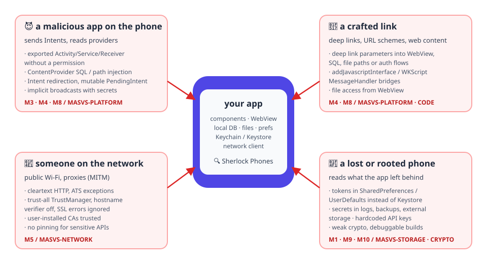

<p align="center">
  
</p>

<p align="center"><i>"Elementary, my dear app."</i></p>

<p align="center"><b>A pocket detective that sniffs out security bugs in Android (and soon iOS) app source code: a Claude Code plugin + MCP server</b></p>

<p align="center">
  
  
  
</p>

[English](#english) · [한국어](#한국어)

<a id="english"></a>

*Sherlock Phones* = Sherlock Holmes, but for **phones**. Point it at your app's source folder in Claude Code and say *"audit this app"*. Claude checks the manifest, walks the app's **attack surface → dangerous code** paths, reads the real code, records only what a real attacker can exploit, then switches sides and re-checks every finding before writing a report mapped to the **OWASP Mobile Top 10** and **MASVS**.

It is the mobile sibling of [mcp-code-agent](https://github.com/yeomyaloo/mcp-code-agent) (Java/Spring servers) and shares its idea: **Claude is the brain, the MCP server is the hands.** Java parsing and call linking come from the shared engine [core-code-agent](https://github.com/yeomyaloo/core-code-agent); this repository adds the mobile parts (manifest and config checks, Android entry points and rules, line rules, the attacker model).

- **Runs on your Claude Code login.** No separate API key, no database, no server to host. Only Java 17+.
- **Reads source only.** It never builds, installs or runs the app, and needs no emulator or device.
- **Fewer false alarms.** Pattern scanners flag every `WebView` and `rawQuery`. Sherlock Phones asks the next question: *can another app, a link, the network or someone holding the phone actually reach it?*

> **Status:** Android phase 1 works (Java fully, Kotlin with line rules). iOS is next; see [Progress](#progress).

## How it works


1. **Load the app** (`load_app`) from a folder or a public Git URL. Every module's `src/main/AndroidManifest.xml` is read; the package comes from the manifest or `namespace` in `build.gradle(.kts)`.
2. **Config checks** that need no parser (`check_config`): `debuggable`, `allowBackup`, `usesCleartextTraffic`, components exported without a permission, and the network security config (cleartext domains, user-installed CAs). `debug-overrides` and `src/debug` manifests are ignored because they are not shipped.
3. **Code graph**: entry points → calls → sinks.
   - Entry points are the exported Activities, Services, Receivers and Providers from the manifest (wired to `onCreate`, `onNewIntent`, `onReceive`, `query`, `openFile`, …), plus `@JavascriptInterface` methods that web pages in a WebView can call.
   - Java gets a full call graph (JavaParser, no Android SDK needed; framework return types like `getIntent()` are known).
   - Kotlin, and patterns a single call cannot show (storage, logs, secrets), use line rules. They are listed as candidates with no path.
4. **Dependencies** (`check_dependencies`): Gradle (and React Native npm) library versions → known vulnerabilities from OSV. Only names and versions leave your machine. Each scan is kept and compared with the previous one.
5. **Claude investigates** each approved item with `read_file` / `grep_code` / `get_callers`, records findings with the attacker and code evidence, and a verifier pass tries to prove each one wrong.
6. **Report** (`export_report`): Markdown or SARIF 2.1.0 (GitHub code scanning), each finding tagged with CWE, OWASP Mobile Top 10, MASVS and the attacker.

## Who attacks a mobile app

Every check is tied to one of four attackers, and the verifier judges a finding against that attacker, not against "someone sending HTTP requests".



## What it checks

✅ Android phase 1 · ⏳ planned

| Area | Android | iOS | OWASP Mobile |
|---|---|---|---|
| Misconfiguration | ✅ exported components without a permission (CWE-926, launcher and deep-link activities are entry points, not findings), `debuggable` (CWE-489), `allowBackup` (CWE-530) | ⏳ URL schemes, entitlements | M8 |
| Insecure communication | ✅ `usesCleartextTraffic` and cleartext domains, user CAs in the network security config, trust-all `X509TrustManager` (classes and anonymous classes), `HostnameVerifier` returning `true`, `SslErrorHandler.proceed()` (CWE-295, CWE-319) | ⏳ ATS exceptions, `URLSession` delegates | M5 |
| Platform interaction | ✅ intent redirection (`getParcelableExtra`, CWE-940), `PendingIntent` (CWE-927), `addJavascriptInterface`, file URL access, `loadUrl`/`loadData`/`evaluateJavascript` (CWE-749, CWE-79), `getSerializableExtra` (CWE-502), dynamic code loading (CWE-94) | ⏳ `WKScriptMessageHandler`, `WKWebView` | M4 |
| Input validation | ✅ `SQLiteDatabase` / `SupportSQLiteDatabase` / `SQLiteQueryBuilder` (CWE-89), file paths (CWE-22), `Runtime.exec` (CWE-78), DOM/SAX XML (CWE-611) | ⏳ `sqlite3_exec`, paths | M4 |
| Data storage | ✅ secrets in `SharedPreferences` (CWE-312), `MODE_WORLD_*` (CWE-732), external storage (CWE-922), secrets in `Log` (CWE-532) | ⏳ `UserDefaults`, `NSLog` | M9 |
| Cryptography | ✅ `Cipher`/`MessageDigest` algorithms, hardcoded `SecretKeySpec` keys (CWE-327, CWE-328, CWE-321), `java.util.Random` (CWE-330) | ⏳ CommonCrypto | M10 |
| Credentials | ✅ AWS, Google, Stripe, GitHub, Slack and LLM keys, private keys, `password = "…"` in code, XML, properties and Gradle files (masked in all output, CWE-798) | ⏳ | M1 |
| Supply chain | ✅ Gradle, version catalogs, lockfiles (and npm for React Native) → OSV | ⏳ CocoaPods, SwiftPM | M2 |

Not in scope: compiled APK/IPA analysis, runtime instrumentation (Frida), binary protections such as obfuscation and anti-tampering (M7).

## Install

**Requirement: Java 17 or later** on your `PATH` (check with `java -version`).

```bash
claude plugin marketplace add yeomyaloo/sherlock-phones
claude plugin install sherlock-phones@yeomyaloo-sherlock-phones
```

Or inside a Claude Code session: `/plugin marketplace add yeomyaloo/sherlock-phones`, then `/plugin install sherlock-phones@yeomyaloo-sherlock-phones`.

Start a new session (or run `/reload-plugins`). The plugin brings the **`sherlock-phones` MCP server** (17 tools, prebuilt in `server/lib`, no build step) and the **`mobile-audit` skill**, which guides the audit: plan → approve → investigate → verify → report. Claude Code starts and stops the server itself; check it with `/mcp` (`plugin:sherlock-phones:sherlock-phones` should be connected; if it failed, Claude Code could not find `java`).

To update later, refresh the marketplace first, then update and restart Claude Code:

```bash
claude plugin marketplace update yeomyaloo-sherlock-phones
claude plugin update sherlock-phones@yeomyaloo-sherlock-phones
```

Without the plugin (Claude Code or Claude Desktop), register the server by hand:

```bash
claude mcp add sherlock-phones --scope user -- java -Dfile.encoding=UTF-8 -cp "C:/path/to/sherlock-phones/server/lib/*" com.sherlockphones.SherlockPhones
```

## Usage

In Claude Code, open any folder and ask:

> Audit the Android app at `C:/work/my-app` for security issues.

Claude loads the app, shows a numbered plan (component or file, category/CWE, attacker, what it will check) and **waits for your approval**. Drop or add items, or reject the plan. Then it investigates, verifies and saves the report under `~/.sherlock-phones/reports/`. The MCP prompt `mobile_audit` does the same from clients that support prompts.

## Tools

| Tool | What it does |
|---|---|
| `load_app` | Load a folder or public Git URL: manifests, config checks, line rules, code graph |
| `list_apps` | Loaded apps |
| `list_components` | Entry points: exported Activity / Service / Receiver / Provider (permission, actions, deep links, authorities, handler methods) and `JS_BRIDGE` methods |
| `list_sink_paths` | Entry point → sink call paths (Java), riskiest first |
| `list_sinks` | All sinks, filter by `category` and `detector` (`code`, `line`, `config`) |
| `check_config` | Manifest settings and config findings (manifest, network security config) |
| `check_dependencies` | Libraries with known vulnerabilities (OSV), compared with the previous scan |
| `find_code_nodes` · `get_callers` · `get_callees` | Navigate the Java code graph |
| `read_file` · `grep_code` | Read and search files inside the app folder only |
| `record_finding` | Record a finding with CWE, severity, **attacker** and file:line evidence |
| `submit_verdict` | Verifier verdict: confirmed / rejected / uncertain |
| `list_findings` · `clear_findings` | Findings (`~/.sherlock-phones/findings/<app>.json`) |
| `export_report` | Markdown or SARIF with CWE, OWASP Mobile Top 10, MASVS and attacker |

Settings (environment variables): `SHERLOCK_PHONES_HOME` (default `~/.sherlock-phones`), `SHERLOCK_PHONES_GIT_HOSTS` (default `github.com,gitlab.com,bitbucket.org`), `SHERLOCK_PHONES_OSV=off` (no OSV requests), `SHERLOCK_PHONES_OSV_URL`.

## Benchmark

[`benchmark/`](benchmark/README.md) has `bank-app`, an Android app with **23 real vulnerabilities** (7 config, 13 Java, 3 Kotlin) and **11 safe look-alikes**, plus an answer key kept outside the app folder.

- `BenchmarkTest` (runs in CI) checks that every item becomes a sink, nothing else does, and each code vulnerability is reachable from its entry point.
- `benchmark/score.py` scores SARIF reports from real audits: recall, precision, trap false positives, and whether repeated audits agree.

## Progress

| # | Step | Status |
|---|---|---|
| 0 | Name, logo, design, threat model | ✅ Done |
| 1-1 | Use the shared engine core-code-agent (0.3.0, `JavaGraphSupport`) instead of a copied Java engine; the benchmark result is unchanged | ✅ Done |
| 1 | Android: manifest and network security config checks, exported components and JS bridges as entry points, Android Java sinks, trust-all TLS detection, Kotlin and storage/log/secret line rules, findings by attacker, OWASP Mobile / MASVS reports, `mobile-audit` skill, benchmark app with an answer key, CI | ✅ Done |
| 2 | iOS: Info.plist / entitlements checks, Swift and Objective-C line rules, iOS benchmark app | ⏳ Planned |
| 3 | tree-sitter parsing for Kotlin and Swift, so paths are followed across files | ⏳ Planned |
| 4 | CocoaPods and SwiftPM dependencies | ⏳ Planned |

## Development

```bash
./gradlew test                              # tests (no network or API key)
python -m unittest discover -s benchmark    # scoring script tests
./gradlew pluginServer                      # rebuild server/lib for the plugin
```

The engine dependency `com.codeagent:core-code-agent` comes from GitHub Packages, which needs a token even for public packages (`gpr.user`/`gpr.key` in `~/.gradle/gradle.properties`). Without one, build against a local checkout: `./gradlew test -PcoreCodeAgentDir=../core-code-agent`.

When you change server code, run `./gradlew pluginServer`, commit `server/lib`, and bump `version` in `.claude-plugin/plugin.json`.

```
.claude-plugin/               plugin manifest + marketplace
skills/mobile-audit/          audit workflow skill
server/lib/                   prebuilt server and dependencies
benchmark/                    bank-app, answer key (outside the app), score.py
src/main/java/com/sherlockphones/
├── SherlockPhones.java       stdio MCP server, tool and prompt registration
├── Prompts.java              mobile_audit, verify_findings prompts, server instructions
├── android/                  manifest reader (safe XML), config checks, Android rules, scanner
├── codegraph/                app graph on top of core-code-agent (components, JS bridges, trust-all TLS), line scanner, categories
├── dependency/               build files + OSV, scan history (same as mcp-code-agent)
├── findings/                 findings with attacker, OWASP Mobile / MASVS mapping, reports
├── source/                   Git URL policy, shallow clone
├── tools/                    MCP tools, argument checks, file access
└── workspace/                settings, loaded apps
```

## Principles

- **Read only.** The app under audit is never built, installed or executed.
- **Code evidence or it didn't happen.** A finding needs a file, a line, the attacker and the code that proves it; the verifier tries to refute every one.
- **Secrets stay secret.** Keys found in the app are masked in tool output, findings and reports.
- **Minimal data leaves the machine.** Only library names and versions go to OSV; source code goes nowhere except to Claude through your own Claude Code session.

## License

[Apache License 2.0](LICENSE). Bundled libraries: [server/THIRD-PARTY.md](server/THIRD-PARTY.md).

## Disclaimer

Use Sherlock Phones only on apps you own or are authorized to test. Automated findings can be wrong in both directions; a clean report is not proof that an app is secure.

---

<a id="한국어"></a>

# 한국어

*Sherlock Phones* = 셜록 **Holmes**에서 **Phones**(폰)로. 폰을 조사하는 셜록이에요. Claude Code에서 앱 소스 폴더를 주고 *"이 앱 보안 검사해줘"*라고 하면, Claude가 매니페스트를 보고 앱의 **공격 입구 → 위험한 코드** 경로를 따라가며 실제 코드를 읽어요. 실제 공격자가 해낼 수 있는 것만 기록하고, 입장을 바꿔 발견마다 다시 확인한 뒤 **OWASP Mobile Top 10**과 **MASVS** 기준으로 보고서를 써요.

[mcp-code-agent](https://github.com/yeomyaloo/mcp-code-agent)(Java/Spring 서버용)의 모바일 버전이고, 같은 생각을 이어받았어요. **Claude는 두뇌, MCP 서버는 손발**이에요. Java 파싱과 호출 연결은 공용 엔진 [core-code-agent](https://github.com/yeomyaloo/core-code-agent)를 쓰고, 이 저장소는 모바일 부분(매니페스트·설정 검사, 안드로이드 입구와 규칙, 줄 단위 규칙, 공격자 모델)을 더해요.

- **Claude Code 로그인으로 돌아요.** 따로 넣을 API 키, DB, 띄울 서버가 없어요. Java 17 이상만 있으면 돼요.
- **소스만 읽어요.** 앱을 빌드하거나 설치하거나 실행하지 않아요. 에뮬레이터나 실제 기기도 필요 없어요.
- **헛경보가 적어요.** 패턴 검사기는 `WebView`, `rawQuery`만 보이면 다 경고해요. Sherlock Phones는 한 걸음 더 물어요. *다른 앱, 링크, 네트워크, 폰을 손에 쥔 사람이 정말 거기까지 닿을 수 있나?*

> **상태:** 안드로이드 1단계가 동작해요 (Java는 호출 경로까지, Kotlin은 줄 단위 규칙). 다음은 iOS예요. [진행 상황](#진행-상황)을 보세요.

## 동작 방식


1. **앱 불러오기** (`load_app`): 폴더나 공개 Git 주소를 받아요. 모듈마다 `src/main/AndroidManifest.xml`을 읽고, 패키지는 매니페스트나 `build.gradle(.kts)`의 `namespace`에서 가져와요.
2. **설정 검사** (`check_config`): 파서 없이 바로 돼요. `debuggable`, `allowBackup`, `usesCleartextTraffic`, 권한 없이 외부에 열린 컴포넌트, 네트워크 보안 설정(평문 HTTP 도메인, 사용자가 설치한 인증서). `debug-overrides`와 `src/debug` 매니페스트는 배포되지 않으니 보지 않아요.
3. **코드 그래프**: 입구 → 호출 → 위험 지점.
   - 입구는 매니페스트에서 외부에 열린 Activity·Service·Receiver·Provider(`onCreate`, `onNewIntent`, `onReceive`, `query`, `openFile` 등으로 이어짐)와, WebView의 웹 페이지가 부를 수 있는 `@JavascriptInterface` 메서드예요.
   - Java는 JavaParser로 호출 관계까지 만들어요. 안드로이드 SDK 없이 돌고, `getIntent()` 같은 프레임워크 메서드의 반환 타입은 알고 있어요.
   - Kotlin과, 호출 하나로는 보이지 않는 패턴(저장소, 로그, 비밀값)은 줄 단위 규칙으로 찾아요. 경로 없는 후보로 나와요.
4. **라이브러리** (`check_dependencies`): Gradle(React Native면 npm도)의 라이브러리 버전 → OSV의 알려진 취약점. 밖으로 나가는 건 이름과 버전뿐이에요. 검사마다 기록을 남기고 지난 검사와 비교해요.
5. **Claude가 조사**: 승인받은 항목마다 `read_file`·`grep_code`·`get_callers`로 실제 코드를 읽고, 공격자와 코드 근거를 붙여 발견을 기록해요. 검증 단계에서는 발견마다 틀렸음을 증명해 보려고 해요.
6. **보고서** (`export_report`): Markdown 또는 SARIF 2.1.0(GitHub 코드 스캐닝). 발견마다 CWE, OWASP Mobile Top 10, MASVS, 공격자를 달아요.

## 누가 모바일 앱을 공격하나

검사 항목은 모두 네 공격자 중 하나와 이어져 있어요. 검증할 때도 "HTTP 요청을 보내는 사람"이 아니라 그 공격자 기준으로 판단해요.


- 😈 **폰에 깔린 악성 앱** (`other_app`): Intent를 보내고 ContentProvider를 읽어요.
- 🔗 **조작된 링크** (`link`): 딥링크와 WebView에 띄운 웹 콘텐츠로 들어와요.
- 📡 **같은 네트워크의 누군가** (`network`): 공용 와이파이나 프록시로 통신을 가로채요(MITM).
- 📱 **잃어버리거나 루팅된 폰** (`device`): 앱이 남긴 저장소, 백업, 로그를 읽어요. APK를 받은 누구나도 여기에 들어가요(하드코딩된 비밀값).

## 검사하는 것

✅ 안드로이드 1단계 · ⏳ 예정

| 분야 | Android | iOS | OWASP Mobile |
|---|---|---|---|
| 설정 오류 | ✅ 권한 없이 외부에 열린 컴포넌트(CWE-926, 런처·딥링크 화면은 발견이 아니라 입구로 봄), `debuggable`(CWE-489), `allowBackup`(CWE-530) | ⏳ URL 스킴, entitlements | M8 |
| 안전하지 않은 통신 | ✅ `usesCleartextTraffic`과 평문 허용 도메인, 네트워크 보안 설정의 사용자 인증서, 모든 인증서를 믿는 `X509TrustManager`(클래스와 익명 클래스), `true`만 돌려주는 `HostnameVerifier`, `SslErrorHandler.proceed()`(CWE-295, CWE-319) | ⏳ ATS 예외, `URLSession` delegate | M5 |
| 플랫폼 연동 | ✅ Intent 리다이렉션(`getParcelableExtra`, CWE-940), `PendingIntent`(CWE-927), `addJavascriptInterface`·파일 URL 접근·`loadUrl`·`loadData`·`evaluateJavascript`(CWE-749, CWE-79), `getSerializableExtra`(CWE-502), 동적 코드 로딩(CWE-94) | ⏳ `WKScriptMessageHandler`, `WKWebView` | M4 |
| 입력 검증 | ✅ `SQLiteDatabase`·`SupportSQLiteDatabase`·`SQLiteQueryBuilder`(CWE-89), 파일 경로(CWE-22), `Runtime.exec`(CWE-78), DOM·SAX XML(CWE-611) | ⏳ `sqlite3_exec`, 경로 | M4 |
| 데이터 저장 | ✅ `SharedPreferences`의 비밀값(CWE-312), `MODE_WORLD_*`(CWE-732), 외부 저장소(CWE-922), `Log`의 비밀값(CWE-532) | ⏳ `UserDefaults`, `NSLog` | M9 |
| 암호화 | ✅ `Cipher`·`MessageDigest` 알고리즘, 하드코딩된 `SecretKeySpec` 키(CWE-327, CWE-328, CWE-321), `java.util.Random`(CWE-330) | ⏳ CommonCrypto | M10 |
| 인증 정보 | ✅ 코드·XML·properties·Gradle 파일의 AWS·Google·Stripe·GitHub·Slack·LLM 키, 개인 키, `password = "…"` (모든 출력에서 가림, CWE-798) | ⏳ | M1 |
| 공급망 | ✅ Gradle, 버전 카탈로그, lockfile(React Native면 npm) → OSV | ⏳ CocoaPods, SwiftPM | M2 |

범위 밖: 빌드된 APK·IPA 분석, 실행 중 계측(Frida), 난독화·위변조 방지 같은 바이너리 보호(M7).

## 설치

**필요한 것: Java 17 이상** (`java -version`으로 확인).

```bash
claude plugin marketplace add yeomyaloo/sherlock-phones
claude plugin install sherlock-phones@yeomyaloo-sherlock-phones
```

Claude Code 세션 안에서는 `/plugin marketplace add yeomyaloo/sherlock-phones` 다음 `/plugin install sherlock-phones@yeomyaloo-sherlock-phones`.

새 세션을 열거나 `/reload-plugins`를 하면 **`sherlock-phones` MCP 서버**(도구 17개, `server/lib`에 미리 빌드되어 있어 빌드 단계 없음)와 **`mobile-audit` 스킬**(계획 → 승인 → 조사 → 검증 → 보고 순서 안내)이 들어와요. 서버는 Claude Code가 알아서 켜고 꺼요. `/mcp`에서 `plugin:sherlock-phones:sherlock-phones`가 연결됨이면 정상이고, 실패면 대개 `java`를 찾지 못한 거예요.

업데이트할 때는 마켓플레이스를 먼저 새로 받은 뒤 업데이트하고 Claude Code를 다시 켜요.

```bash
claude plugin marketplace update yeomyaloo-sherlock-phones
claude plugin update sherlock-phones@yeomyaloo-sherlock-phones
```

플러그인 없이(Claude Code, Claude Desktop) 직접 등록할 수도 있어요.

```bash
claude mcp add sherlock-phones --scope user -- java -Dfile.encoding=UTF-8 -cp "C:/path/to/sherlock-phones/server/lib/*" com.sherlockphones.SherlockPhones
```

## 사용법

Claude Code에서 아무 폴더나 열고 이렇게 말하면 돼요.

> `C:/work/my-app` 안드로이드 앱 보안 검사해줘.

Claude가 앱을 불러와 번호 붙은 계획(컴포넌트나 파일, 분류·CWE, 공격자, 확인할 것)을 보여주고 **승인을 기다려요**. 항목을 빼거나 더하거나 계획을 거절할 수 있어요. 승인하면 조사하고, 검증하고, 보고서를 `~/.sherlock-phones/reports/`에 저장해요. 프롬프트를 지원하는 클라이언트에서는 MCP 프롬프트 `mobile_audit`으로도 같은 일을 해요.

## 도구

| 도구 | 하는 일 |
|---|---|
| `load_app` | 폴더나 공개 Git 주소를 불러와 매니페스트, 설정 검사, 줄 단위 규칙, 코드 그래프를 만든다 |
| `list_apps` | 불러온 앱 목록 |
| `list_components` | 입구: 외부에 열린 Activity·Service·Receiver·Provider(권한, 액션, 딥링크, authorities, 입력을 받는 메서드)와 `JS_BRIDGE` 메서드 |
| `list_sink_paths` | 입구 → 위험 지점 호출 경로(Java), 위험한 것부터 |
| `list_sinks` | 위험 지점 전체. `category`, `detector`(`code`, `line`, `config`)로 거르기 |
| `check_config` | 매니페스트 설정과 설정 문제(매니페스트, 네트워크 보안 설정) |
| `check_dependencies` | 알려진 취약점(OSV)이 있는 라이브러리, 지난 검사와 비교 |
| `find_code_nodes` · `get_callers` · `get_callees` | Java 코드 그래프 탐색 |
| `read_file` · `grep_code` | 앱 폴더 안의 파일만 읽고 검색한다 |
| `record_finding` | CWE, 심각도, **공격자**, 파일:줄 근거와 함께 발견 기록 |
| `submit_verdict` | 검증 판정: confirmed / rejected / uncertain |
| `list_findings` · `clear_findings` | 발견 (`~/.sherlock-phones/findings/<앱>.json`) |
| `export_report` | CWE, OWASP Mobile Top 10, MASVS, 공격자를 단 Markdown 또는 SARIF |

설정(환경 변수): `SHERLOCK_PHONES_HOME`(기본 `~/.sherlock-phones`), `SHERLOCK_PHONES_GIT_HOSTS`(기본 `github.com,gitlab.com,bitbucket.org`), `SHERLOCK_PHONES_OSV=off`(OSV에 묻지 않음), `SHERLOCK_PHONES_OSV_URL`.

## 벤치마크

[`benchmark/`](benchmark/README.md)에 안드로이드 앱 `bank-app`이 있어요. **진짜 취약점 23개**(설정 7, Java 13, Kotlin 3)와 **안전한 함정 11개**를 섞었고, 정답 파일은 앱 폴더 밖에 둬요.

- `BenchmarkTest`(CI에서 돈다)는 모든 항목이 위험 지점이 되고 그 밖의 것은 없으며, 코드 취약점마다 입구에서 이어지는지 확인해요.
- `benchmark/score.py`는 실제 분석의 SARIF 보고서를 채점해요: 재현율, 정밀도, 함정 오탐, 여러 번 돌려도 같은 결론인지.

## 진행 상황

| # | 단계 | 상태 |
|---|---|---|
| 0 | 이름, 로고, 설계, 위협 모델 | ✅ 완료 |
| 1-1 | 복사해 둔 Java 엔진 대신 공용 엔진 core-code-agent(0.3.0, `JavaGraphSupport`)를 씀. 벤치마크 결과는 그대로 | ✅ 완료 |
| 1 | Android: 매니페스트·네트워크 보안 설정 검사, 외부에 열린 컴포넌트·JS 브리지를 입구로, 안드로이드 Java 위험 지점, 모든 인증서를 믿는 TLS 구현 찾기, Kotlin과 저장소·로그·비밀값 줄 단위 규칙, 공격자별 발견, OWASP Mobile·MASVS 보고서, `mobile-audit` 스킬, 정답이 있는 벤치마크 앱, CI | ✅ 완료 |
| 2 | iOS: Info.plist·entitlements 검사, Swift·Objective-C 줄 단위 규칙, iOS 벤치마크 앱 | ⏳ 예정 |
| 3 | Kotlin·Swift를 tree-sitter로 파싱해 파일을 넘나드는 경로 추적 | ⏳ 예정 |
| 4 | CocoaPods·SwiftPM 라이브러리 검사 | ⏳ 예정 |

## 개발

```bash
./gradlew test                              # 테스트 (네트워크·API 키 불필요)
python -m unittest discover -s benchmark    # 채점 스크립트 테스트
./gradlew pluginServer                      # 플러그인용 server/lib 다시 만들기
```

엔진 `com.codeagent:core-code-agent` 는 GitHub Packages 에서 받는데, 공개 패키지여도 토큰이 필요해요(`~/.gradle/gradle.properties` 의 `gpr.user`/`gpr.key`). 토큰이 없으면 로컬 소스로 빌드해요: `./gradlew test -PcoreCodeAgentDir=../core-code-agent`.

서버 코드를 바꾸면 `./gradlew pluginServer`로 `server/lib`를 다시 만들어 커밋하고 `.claude-plugin/plugin.json`의 `version`을 올려요.

```
.claude-plugin/               플러그인 정보 + 마켓플레이스
skills/mobile-audit/          분석 순서 스킬
server/lib/                   미리 빌드한 서버와 의존 라이브러리
benchmark/                    bank-app, 정답 파일(앱 밖), score.py
src/main/java/com/sherlockphones/
├── SherlockPhones.java       stdio MCP 서버, 도구·프롬프트 등록
├── Prompts.java              mobile_audit, verify_findings 프롬프트, 서버 안내문
├── android/                  매니페스트 읽기(안전한 XML), 설정 검사, 안드로이드 규칙, 스캐너
├── codegraph/                core-code-agent 위의 앱 그래프(컴포넌트, JS 브리지, 모든 인증서를 믿는 TLS), 줄 단위 스캐너, 분류
├── dependency/               빌드 파일 + OSV, 검사 기록 (mcp-code-agent 와 같음)
├── findings/                 공격자가 붙은 발견, OWASP Mobile·MASVS 분류, 보고서
├── source/                   Git 주소 검사, 얕은 클론
├── tools/                    MCP 도구, 인자 검사, 파일 접근
└── workspace/                설정, 불러온 앱
```

## 원칙

- **읽기만 한다.** 검사하는 앱을 빌드, 설치, 실행하지 않는다.
- **코드 근거가 없으면 발견이 아니다.** 발견에는 파일, 줄, 공격자, 그걸 증명하는 코드가 있어야 하고, 검증 단계가 하나하나 반박해 본다.
- **비밀값은 비밀로.** 앱에서 찾은 키는 도구 결과, 발견, 보고서 어디에서나 가린다.
- **밖으로 나가는 데이터는 최소로.** OSV에는 라이브러리 이름과 버전만 보낸다. 소스코드는 내 Claude Code 세션을 통해 Claude에게 가는 것 말고는 어디에도 올리지 않는다.

## 라이선스

[Apache License 2.0](LICENSE). 함께 배포하는 라이브러리: [server/THIRD-PARTY.md](server/THIRD-PARTY.md).

## 면책

본인 소유이거나 검사 권한을 받은 앱에만 쓰세요. 자동 분석 결과는 양쪽으로 틀릴 수 있어요. 깨끗한 보고서가 앱이 안전하다는 증거는 아니에요.
